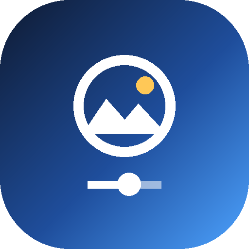

# Snapedit

<p align="center">
  
</p>

<p align="center">
  <strong>High-precision, non-destructive photo editing suite for Android.</strong><br>
  Built with Kotlin and Jetpack Compose. Inspired by Snapseed and Lightroom Mobile.
</p>

<p align="center">
  <a href="https://github.com/BorgorNinja/Snapedit/releases/latest"></a>
  
  
  
  
  
</p>

---

## Overview

**Snapedit** is an open-source, full-featured mobile photo manipulation engine designed for photographers and digital creators. It blends the intuitive gesture-driven workflows of Snapseed with the granular parametric precision of Lightroom—all running 100% locally on-device without telemetry, network requests, or third-party cloud processing.

Every edit in Snapedit is non-destructive: every slider, tone curve point, brush stroke, and filter is recorded into a modular operation stack that you can inspect, toggle, re-tune, or reset at any stage of your workflow.

---

## Features

### 1. Tone, Light & Exposure
* **Tune Image:** Dynamic adjustment of Brightness, Contrast, Saturation, Ambiance, Highlights, Shadows, and Warmth.
* **Light Engine:** Fine-grained sliders for Exposure (EV stops), Contrast, Highlights, Shadows, Whites, and Blacks.
* **Tonal Contrast:** Local contrast separation targeting high, mid, and low tonal frequencies independently.
* **Real-time Histogram:** Interactive overlay showing live RGB and Luminance distribution as adjustments are dialed in.

### 2. Color & Professional Grading
* **Curves:** Interactive spline-interpolated curve editor supporting composite RGB, Red, Green, and Blue channels.
* **Color Mixer (HSL):** 8 discrete spectral bands (Red, Orange, Yellow, Green, Aqua, Blue, Purple, Magenta) with dedicated Hue, Saturation, and Luminance controls.
* **Color Grading:** 3-way split-toning wheels for Shadows, Midtones, and Highlights with balance and blending bias.
* **White Balance:** Calibrated Temperature (Kelvin shift) and Tint (green/magenta balancing).

### 3. Precision Detail & Optics
* **Structure & Sharpening:** High-pass unsharp masking and local edge-definition contrast without halo artifacts.
* **Presence:** High-fidelity Texture, Clarity, Dehaze, and Edge Vignetting.
* **Noise Reduction:** Multi-stage spatial noise filtering for luminance grain and chroma color speckling.
* **Lens Correction & Optics:** Barrel/pincushion geometric distortion compensation, chromatic aberration correction, and lens vignetting removal.

### 4. Spatial, Selective & Inpainting Tools
* **Selective Control Points:** Drop localized target points onto colors to selectively modify Brightness, Contrast, and Saturation within a radius (U-point style).
* **Brush Masking:** Paint-on adjustments (Exposure, Dodge & Burn, Temperature, Saturation) with variable radius and erase mode.
* **Graduated & Radial Filters:** Linear gradient and radial falloff masks with feathering and inversion options.
* **Healing (Inpainting):** Content-aware spot and blemish remover with adjustable stamp brush radius.
* **Red Eye Removal:** Target-tap pupil correction for portrait photography.
* **Liquify:** Warping engine featuring Push, Bloat, and Reconstruct modes for gentle contour shaping.

### 5. Creative Looks & Film Simulation
* **HDR Scape:** High Dynamic Range simulation with natural exposure blending.
* **Glamour Glow & Drama:** Soft glow diffusion and high-impact gritty tonal treatments.
* **Vintage & Retrolux:** Classic film emulsions, subtle light leaks, scratches, and age styling.
* **Grainy Film & Noir:** Authentic analog photographic silver-halide grain and high-contrast monochrome cinema looks.
* **Black & White:** Grayscale conversion powered by colored optical filter simulations (Neutral, Red, Orange, Yellow, Green).
* **Frames & Typography:** Customizable photographic borders, clean text overlays, and alignment controls.

### 6. Workflow, Stacks & Looks
* **Non-destructive Edit Stack:** View the full layer stack of applied tools; toggle visibility of any past adjustment or re-enter and refine past parameters without losing subsequent edits.
* **User Looks (Presets):** Save your active adjustment recipes to the device and apply them to any subsequent photo in one tap.
* **Dynamic Theming:** Seamless system, dark, and light mode themes with custom runtime-tinted monochrome vector iconography.
* **Before / After Comparison:** Long-press anywhere on the preview canvas to toggle instant real-time before/after comparison.

---

## Download & Installation

Pre-compiled APKs are built automatically on every commit via GitHub Actions.

1. Navigate to the **[Releases](https://github.com/BorgorNinja/Snapedit/releases)** section.
2. Download either:
   * **`Snapedit.apk`** / **`Snapedit-Release.apk`**: Optimized release build signed with standard install certificates (recommended).
   * **`Snapedit-Debug.apk`**: Debug build with logcat diagnostics enabled.
3. On your Android device, open the downloaded `.apk` file and tap **Install** (ensure *Allow installs from unknown sources* is enabled in your browser or file manager settings).

---

## Building from Source

### Prerequisites
* **Java Development Kit (JDK):** JDK 17 or higher
* **Android SDK:** 
  * `compileSdk`: 35
  * `minSdk`: 29 (Android 10+)
  * `targetSdk`: 35
* **Git**

### Clone the Repository
```bash
git clone https://github.com/BorgorNinja/Snapedit.git
cd Snapedit
```

### Build via Command Line (Gradle Wrapper)
To assemble both Release and Debug APKs:
```bash
# On Linux / macOS
chmod +x gradlew
./gradlew assembleRelease assembleDebug

# On Windows
gradlew.bat assembleRelease assembleDebug
```

Generated APKs will be located in:
* Release APK: `app/build/outputs/apk/release/app-release.apk`
* Debug APK: `app/build/outputs/apk/debug/app-debug.apk`

### Open in Android Studio
1. Launch **Android Studio** (Ladybug / Koala or newer recommended).
2. Select **Open** and select the root `Snapedit` folder.
3. Let Gradle complete project sync.
4. Select `app` in the run configurations dropdown and click **Run** (or press `Shift + F10`) to deploy to a connected device or emulator.

---

## Architecture & Tech Stack

* **Language:** Kotlin 2.0
* **UI Toolkit:** Jetpack Compose with Material 3 design system
* **Concurrency:** Kotlin Coroutines (`Dispatchers.Default` for non-blocking bitmap rendering, `Dispatchers.Main` for UI updates)
* **Rendering Engine:** Custom memory-efficient pure Kotlin multi-pass bitmap pipeline operating directly on ARGB pixel arrays with fast integer math
* **Architecture:** Unidirectional Data Flow (UDF) with immutable parameter structs and reactive Compose states

---

## Contributing

Contributions, bug reports, and pull requests are welcome! If you encounter an issue or have a feature suggestion, please open an issue on GitHub.

---

## License

This project is licensed under the Apache License 2.0. See the LICENSE file for details.
